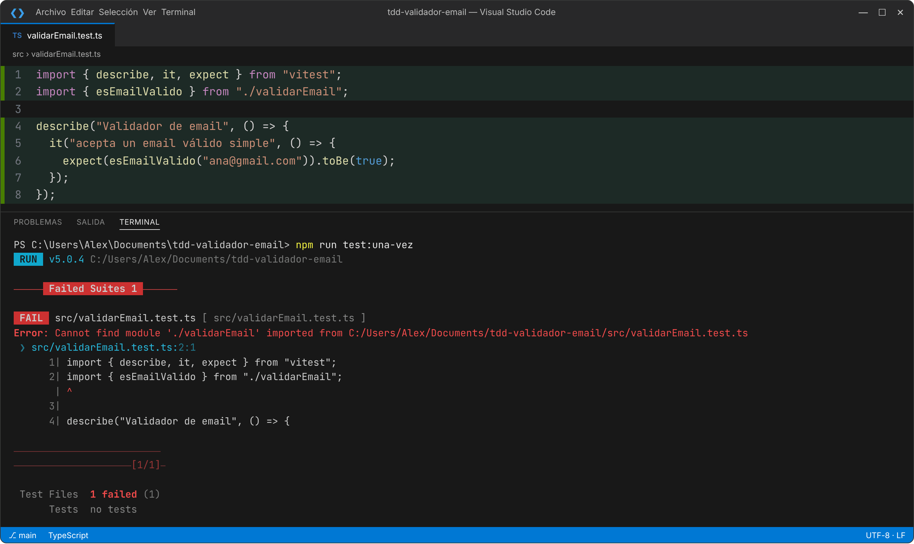
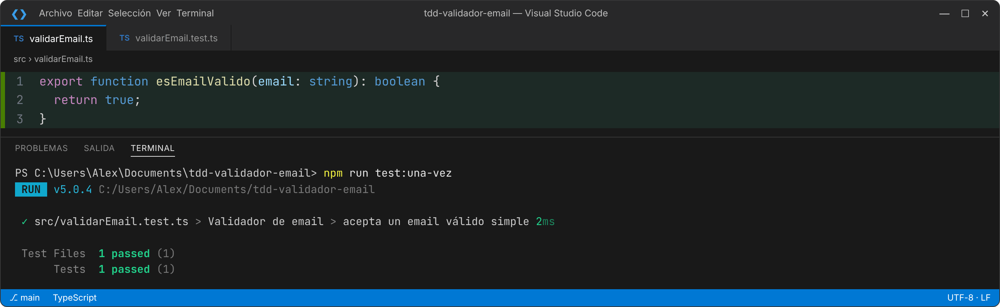
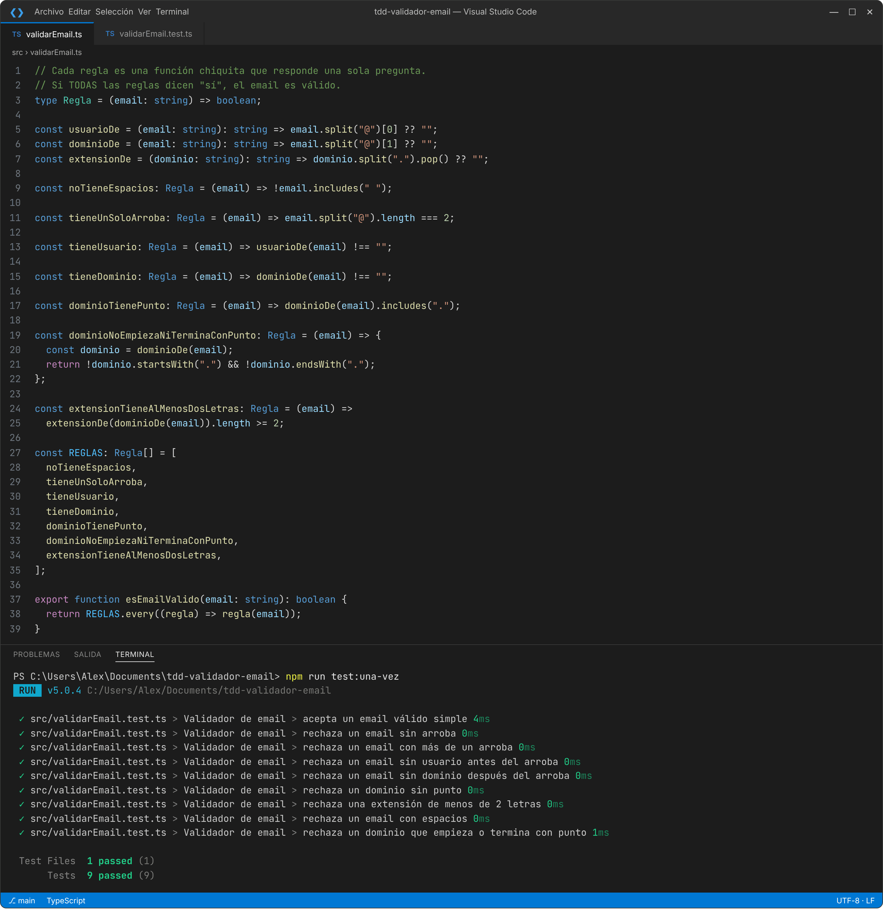
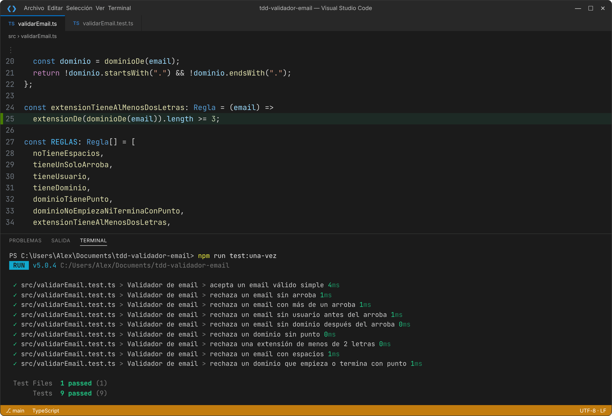

# TDD en la práctica: validador de emails en TypeScript

Ejemplo de punta a punta de **Test-Driven Development (TDD)** para la comunidad de prácticas de Scrum Masters: cómo se construye una funcionalidad real escribiendo **primero el test** y después el código, en ciclos cortos de **🔴 Rojo → 🟢 Verde → 🔵 Refactor**.

## El problema de negocio

> *Como usuario que se registra, quiero que el sistema me avise si escribí mal mi email, para no quedarme sin recibir la confirmación.*

Reglas que fuimos descubriendo test por test:

| # | Regla | Ejemplo que se rechaza |
|---|---|---|
| 1 | Tiene que tener un arroba | `anagmail.com` |
| 2 | Solo un arroba | `ana@@gmail.com` |
| 3 | Tiene que haber usuario antes del arroba | `@gmail.com` |
| 4 | Tiene que haber dominio después del arroba | `ana@` |
| 5 | El dominio necesita un punto | `ana@gmail` |
| 6 | La extensión tiene al menos 2 letras | `ana@gmail.c` |
| 7 | Sin espacios | `ana perez@gmail.com` |
| 8 | El dominio no empieza ni termina con punto | `ana@.com` |

## Cómo correrlo

Requisitos: [Node.js](https://nodejs.org) LTS y Git.

```bash
npm install            # instala dependencias (una sola vez)
npm test               # corre los tests en modo vigilancia (se re-ejecutan al guardar)
npm run test:una-vez   # corre los tests una vez y termina
npm run demo -- ana@gmail.com juan@   # usa el validador "de verdad"
```

## Qué hay en el repo

```
src/
  validarEmail.ts         ← el código (resultado final, ya refactorizado)
  validarEmail.test.ts    ← los tests (la especificación ejecutable)
  demo.ts                 ← mini programa para probar emails desde la terminal
demo-en-vivo/             ← el contenido exacto de cada paso, para la demo en vivo
.github/workflows/        ← integración continua: GitHub corre los tests en cada push
GUIA-DEMO.md              ← instalación en Windows + guion de la presentación
```

## El historial cuenta la historia

Cada commit es un paso del ciclo de TDD. Mirá la pestaña **Commits**:

- 🔴 **RED** — se agrega un test que falla (describe algo que el código todavía no hace)
- 🟢 **GREEN** — el código mínimo para que pase
- 🔵 **REFACTOR** — se mejora el diseño sin cambiar el comportamiento (los tests siguen en verde)
- 🧪 **TEST** — se agrega un caso que faltaba (detectado al refactorizar)

La rama `demo-inicio` tiene el proyecto configurado pero sin código: es el punto de partida para hacer la demo en vivo.

## Stack

- **TypeScript** — JavaScript con tipos
- **Vitest** — framework de tests
- **GitHub Actions** — integración continua

## Capturas

| 🔴 Ciclo 1: el test falla porque el código no existe | 🟢 Ciclo 1: código mínimo, test en verde |
|---|---|
|  |  |

| 🔵 Refactor: mismas reglas, código legible, todo en verde | 🧪 Un error en el refactor que los tests NO detectaron (faltaba un caso) |
|---|---|
|  |  |

Todas las capturas de cada paso están en [`docs/capturas`](docs/capturas).
